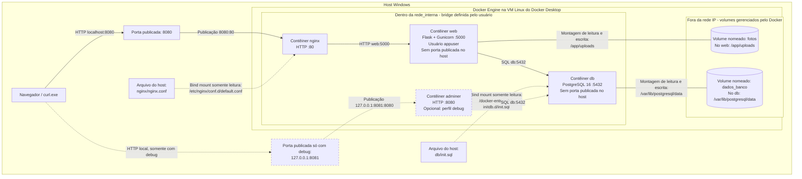

# A2 - Diagrama de arquitetura

O diagrama representa a configuração atual de [docker-compose.yml](../docker-compose.yml). Os dois contêineres principais são web e db; o Nginx fornece o proxy do bônus, e o Adminer é opcional, ativado pelo perfil debug.

## Como ler o diagrama

- **Setas HTTP e SQL:** representam comunicação pela rede. O usuário acessa `localhost:8080`; o Nginx encaminha ao web, que consulta o banco.
- **Linhas de montagem:** representam acesso a armazenamento. As fotos ficam no volume `fotos`, montado em `/app/uploads`; os arquivos do PostgreSQL ficam em `dados_banco`, montado em `/var/lib/postgresql/data`.
- **Setas de bind mount:** disponibilizam arquivos do host dentro dos contêineres. O `:ro` do Compose torna `init.sql` e `nginx.conf` somente leitura nesses mounts.
- **Caminho de debug tracejado:** representa o Adminer opcional, que não inicia no comando normal. As outras ligações tracejadas estão identificadas como bind mounts.

## Onde cada volume fica

| Volume nomeado | Caminho dentro do contêiner | Local do conteúdo no daemon Linux |
|---|---|---|
| `fotos` | `/app/uploads` no web | `/var/lib/docker/volumes/achados-perdidos_fotos/_data` |
| `dados_banco` | `/var/lib/postgresql/data` no db | `/var/lib/docker/volumes/achados-perdidos_dados_banco/_data` |

São dois caminhos para acessar o mesmo armazenamento: o contêiner usa o ponto de montagem, enquanto o Docker gerencia o conteúdo no diretório do volume. Os locais no daemon foram identificados pelo [docker volume inspect da Tarefa 5](evidencias/tarefa-5/06b-inspecao-volumes.png). Neste projeto com Docker Desktop, esses diretórios ficam no sistema de arquivos da VM Linux, armazenado no disco virtual do Docker; não são caminhos diretos de pastas do Windows.

## Dentro e fora da rede interna

**Dentro da bridge:** web, db e nginx; o Adminer também participa quando seu perfil é ativado. O DNS interno do Docker permite usar os nomes `web` e `db` em vez de fixar seus IPs.

**Fora da bridge:** navegador/curl, portas de entrada do host e arquivos do repositório. Os volumes também ficam fora da rede IP, embora sejam administrados pelo Docker: não têm IP nem recebem requisições HTTP. Seu conteúdo é acessado pelos caminhos montados nos contêineres.

No Docker Desktop, o daemon e seus volumes ficam no ambiente Linux da VM, armazenado em disco virtual no Windows. A rede se chama `rede_interna`, mas isso não ativa a opção Docker `internal: true`; a proteção mostrada aqui inclui a ausência de publicação da porta do banco.

## Portas e inicialização

| Serviço | Porta no contêiner | Publicação no host |
|---|---|---|
| nginx | 80 | `8080:80` |
| web | 5000 | Nenhuma |
| db | 5432 | Nenhuma |
| adminer | 8080 | `127.0.0.1:8081:8080`, somente com perfil debug |

O bônus de proxy substitui a ligação básica `host:8080 → web:5000` por **`host:8080 → nginx:80 → web:5000`**. Na subida, o Compose aguarda o banco saudável antes de iniciar o web e o web saudável antes de iniciar o Nginx. O Adminer, quando solicitado, também aguarda o banco saudável.

O arquivo `init.sql` prepara a tabela e os exemplos quando o volume do banco está vazio; montá-lo não significa executar seu conteúdo em todo reinício. Os volumes preservam dados após `down`, mas são removidos com `down -v`, conforme demonstrado nas [evidências da Tarefa 5](evidencias/README.md).
